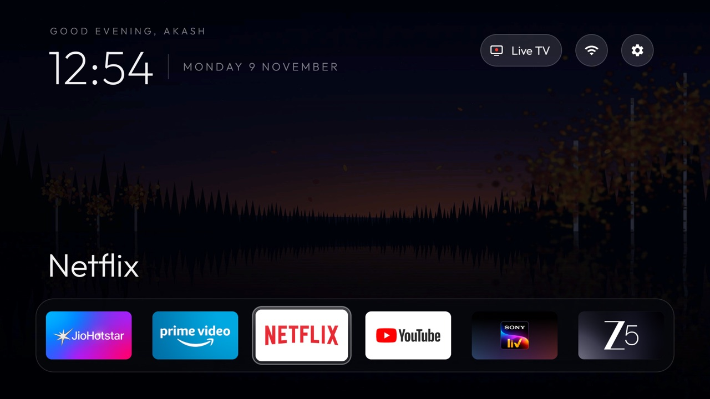
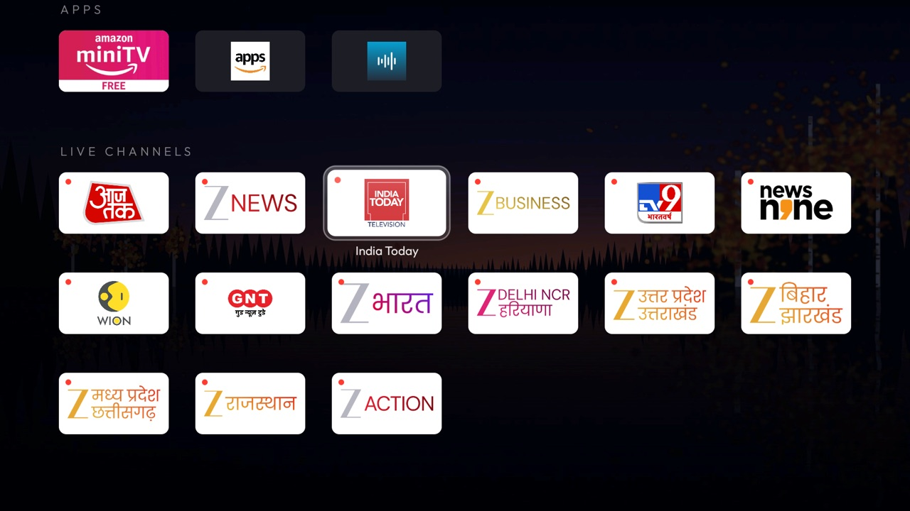
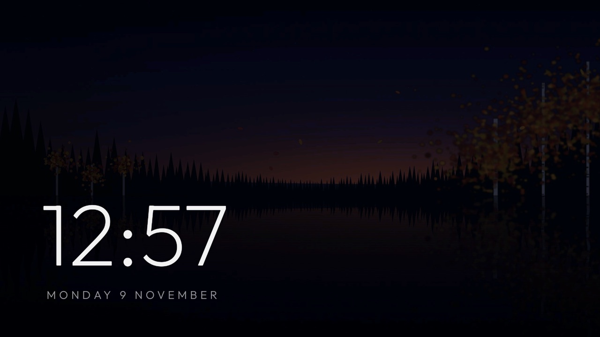

# Fire TV debloat + Rusty

Rusty is a small, Apple TV-style home screen for an Amazon Fire TV Stick, plus scripts that debloat Fire OS over ADB without root.

| Home | Apps and live channels | Ambient mode |
|---|---|---|
|  |  |  |

Device: Amazon Fire TV Stick 3rd gen (AFTSSS, "sheldonp"), Fire OS 7.7.1.7 / Android 9, about 900 MB RAM, at `192.168.1.18`.

## What's here

| File | What it does |
|---|---|
| `tv`, `tv.py` | Tiny ADB client: `./tv sh '<cmd>'`, `./tv key DPAD_DOWN HOME`, `./tv shot out.png`, `./tv push local remote`. Set `TV_IP=` for another address. |
| `backup.sh` | Snapshots the TV before any change into `backup/` (gitignored: it holds device identifiers): full / system / third-party / disabled package lists, `getprop`, all `settings` namespaces, the original home activity, a baseline screenshot. |
| `debloat.sh` + `debloat_list.txt` | Disables every package in the list, one `pm` call each, and logs successes to `backup/disabled_by_us.txt`. |
| `restore.sh` | Undoes everything: re-enables every logged package, switches the Rusty service off, hands Home back to Amazon. |
| `build_install.sh` | Builds the launcher (R8-optimised release APK), installs it, grants the Wi-Fi-name permission, pushes channels and the wallpaper. |
| `enable_home_button.sh` | Switches on Rusty's accessibility service (see "How Rusty is reached"). |
| `collect_channels.py` | Rebuilds `channels/channels.json` from the TV's Live TV guide (see "Live channels"). |
| `push_channels.sh` | Copies `channels/channels.json` (and any logos) to Rusty on the TV. `build_install.sh` runs it too. |
| `channels/` | `channels.json` (the live channels Rusty shows: name, link that opens the channel, logo, tile colour), the logo PNGs and their `CREDITS.md`. |
| `launcher/` | Rusty source (Java, AndroidX RecyclerView, minSdk 28). |
| `themes/ruska/` | The Ruska wallpaper and its credits. |
| `docs/` | README screenshots. |

### Setting up a fresh TV

```bash
./backup.sh            # first, before changing anything
./debloat.sh           # edit debloat_list.txt first
./build_install.sh     # build, install Rusty, push channels and wallpaper
./enable_home_button.sh
```

### Why `tv` and not `adb`

macOS Local Network privacy blocks Homebrew's `adb` ("No route to host") and the venv's copied Python. Apple's `/usr/bin/python3` with the `adb-shell` package works, and `tv` recreates `.venv` if it's missing. A terminal app also needs **System Settings › Privacy & Security › Local Network** switched on for it. Large `adb push` transfers hang on this link, so `tv push` sends base64 chunks through the shell and checks the md5.

## Debloat

42 packages disabled with `pm disable-user --user 0` (never uninstalled): Amazon telemetry, ad and recommendation services, multi-room audio, Matter, setup helpers, preloaded apps, Silk, Amazon miniTV (a stub that only opens the Appstore), Airtel Xstream and Stremio. Full list with categories: `debloat_list.txt`.

Kept at your request: Prime Video, YouTube, Netflix, JioHotstar, SonyLIV, ZEE5, Appstore, Live TV, Alexa, casting, screen mirroring, OS updates.

Fire OS refused 7 as protected (they stay on): `device.metrics`, `device.crashmanager`, `device.logmanager`, `device.rdmapplication`, `fireos.usagestats.proxy`, `ftvads.deeplinking`, `tv.csapp`.

### Re-enable one app

```bash
./tv sh 'pm enable com.stremio.one'
```

Use any package name from `debloat_list.txt` or `backup/disabled_by_us.txt`. To disable one again: `./tv sh 'pm disable-user --user 0 <package>'`.

### Undo everything

```bash
./restore.sh
```

Optionally remove the launcher too: `./tv sh 'pm uninstall dev.akash.rusty'`.

A Fire OS update can quietly re-enable disabled packages. Rerun `./debloat.sh` after updates; it skips nothing, and already-disabled packages just report their state.

## Rusty launcher

Apple TV-style home screen with a look inspired by the **Ruska** theme from [CleanYourTV](https://github.com/Gathin23/cleanyourtv) (MIT; see `themes/ruska/CREDITS.md`):
- Blue-black `#07080D` background under Ruska's autumn-lake wallpaper (pushed to the TV; see "Change the wallpaper").
- A small letter-spaced uppercase greeting, then the clock, a thin divider and the uppercase date on one line, in Outfit (OFL-licensed; the licence is in `assets/fonts/OFL.txt`).
- A frosted "Live TV" pill (screen icon with a red live dot), then Wi-Fi and Settings as round frosted icons that widen to show the network name / "Settings" when selected. Live TV opens **Xiaomi TV+** (`LIVE_TV_APP` in `HomeActivity.java`), which starts straight into full-screen live TV: Up/Down flip channels, Left opens its channel list, Back toggles its menu. Press Menu to return to Rusty. Xiaomi TV+ is hidden from the Apps row; if it's ever uninstalled, the pill falls back to Fire TV's Live TV guide (`livetv://showEpg`).
- A translucent dock band with a hairline rim, holding JioHotstar · Prime Video · Netflix · YouTube · SonyLIV · ZEE5, with the focused app's name above it.
- Below the dock, the page scrolls up on Down into two sections in a 6-column grid:
  - **Apps:** the remaining apps on one row. With more than 6 apps, the last tile is **+N more**; pressing it shows every app and the tile becomes **Show less**. That choice is remembered.
  - **Live channels:** every channel from `channels.json` as a white logo tile (or its name) with a red live dot; OK opens the channel straight in its app (ZEE5 today).
- One white glass highlight that springs between tiles; the focused tile scales up and shows its name.

Ambient touches:
- **Parallax:** the wallpaper slides a few pixels against every focus move (`PARALLAX_X_DP` / `PARALLAX_Y_DP`). It only moves on a key press.
- **Entrance:** coming back to Rusty, the clock, pills, app name and dock rise and fade in, staggered.
- **Time of day:** `wallpaper.jpg` is colour-graded by the hour: morning 5–11 (lighter), day 11–17 (as drawn), evening 17–20 (warmer), night 20–5 (darker, moonlit blue). To use your own picture for a time of day instead, push `wallpaper_morning.jpg`, `wallpaper_day.jpg`, `wallpaper_evening.jpg` or `wallpaper_night.jpg` next to `wallpaper.jpg`; those are shown as-is.
- **Ambient mode:** after 3 idle minutes the UI fades away, leaving a large clock and the date over the wallpaper, which sways slowly. Any key brings the home screen back; that key does nothing else. Fire TV's own screensaver still takes over at 5 minutes (`screen_off_timeout`).

Measured on this stick (A/B against the same build with the effects off): 0% CPU whenever nothing moves, navigation timing unchanged (90% of frames in about 10 ms), memory unchanged within noise (~91–104 MB PSS, mostly screen buffers, the wallpaper and tile images). Ambient mode costs roughly 15–25% CPU while it runs (between 3 and 5 idle minutes). An earlier falling-leaves effect was removed.

D-pad rules:
- Up/Down move exactly one row, across sections too, keeping the column where the next row is long enough; Down from the dock goes to the tile directly below.
- Up from the dock goes to the top bar, and the ends of the top bar stop there.
- Back in the grid returns to the dock.
- The last focused tile is remembered across app launches and restarts.

Light on resources: no blur, no video, no network polling. The clock is a `TextClock`; the greeting and wallpaper mood update on the system's minute tick; the only timer is the ambient drift, which runs only during ambient mode.

### How Rusty is reached (Fire OS limits)

Fire OS won't let its launcher be disabled, hidden or replaced without root (`pm disable-user`, `pm hide` and component disable are all refused). It also handles **Home** itself and then blocks other apps' launches for 5 seconds. So:

- **Menu (☰) on the remote opens Rusty instantly**, from anywhere. Apps therefore no longer receive the Menu button.
- **Home stays Amazon's.**
- **After a reboot**, Rusty replaces Amazon's home once.
- **Settings pill** opens Fire TV's real Settings, which live inside Amazon's home, so Back from Settings lands there. Press Menu to return.

All of this comes from Rusty's accessibility service (`HomeKeyService`). It only watches for the Menu key and Amazon's home window, and reads no screen content.

- If Menu stops working, run `./enable_home_button.sh`.
- **Never `am force-stop dev.akash.rusty`**: Android removes a force-stopped app's accessibility service from the enabled list. If it then won't come back even with the enable script, reboot the TV (`./tv sh reboot`).

### Rebuild / reinstall

```bash
./build_install.sh
```

This needs JDK 21 and the Android SDK at `~/Library/Android/sdk` (override with `JAVA_HOME` / `ANDROID_HOME`). It uses Gradle 9.7.1 and AGP 9.4.0. Reinstalling keeps the service enabled.

It builds the **release** variant: R8 shrinking and optimisation plus resource shrinking, signed with the local debug key (`signingConfig = signingConfigs.debug`) so it updates the installed app in place. Building on another machine means a different debug key: uninstall Rusty first, then rerun this and `./enable_home_button.sh`. Measured against the debug build on this stick:

| | Debug | Release (R8) |
|---|---|---|
| APK size | 7.1 MB | 367 KB |
| Warm start (5 runs) | 147–507 ms, median 394 | 128–243 ms, median 160 |
| Code memory | 6.0 MB | 1.9 MB |
| Java heap | 4.6 MB | 2.8 MB |

Android compiles the release build ahead of time at install (`speed-profile`, using AndroidX's bundled startup profile); a debug build is marked debuggable and runs mostly interpreted.

### Change the dock order or apps (no rebuild)

Put one package per line, left to right, in `dock.txt` and push it. It takes effect the next time Rusty comes to the front (press Menu):

```bash
printf 'com.netflix.ninja\ncom.amazon.firetv.youtube\nin.startv.hotstar\ncom.amazon.firebat\n' > dock.txt
./tv push dock.txt /sdcard/Android/data/dev.akash.rusty/files/dock.txt
```

Package names: JioHotstar `in.startv.hotstar`, Prime Video `com.amazon.firebat`, Netflix `com.netflix.ninja`, YouTube `com.amazon.firetv.youtube`, SonyLIV `com.onemainstream.sonyliv.android`, ZEE5 `com.zee5.amazon`. List all launchable apps with `./tv sh 'pm list packages'`.

To go back to the built-in order, delete the file:

```bash
./tv sh 'rm /sdcard/Android/data/dev.akash.rusty/files/dock.txt'
```

The built-in default is `DEFAULT_DOCK` in `HomeActivity.java`.

### Live channels

Fire OS keeps the Live TV guide's channel list private to Amazon's own apps, so Rusty can't read it directly. But the guide logs each channel, with the exact link Amazon uses to play it, as you move through it. `collect_channels.py` opens the guide, steps through it and saves those channels:

```bash
./collect_channels.py
./push_channels.sh
```

Run both again when channels change (for example after installing an app that adds channels to the guide); then press Menu. Today the guide has 19 free ZEE5 channels; Rusty shows 15 of them. Xiaomi TV+ (`com.mitv.tvhome.mitvplus`) registers its own live-TV source, but Amazon's guide doesn't list it, and it keeps its channel list inside the app (hidden in Android's TV database, nothing logged), so its channels can't be added here; use its own channel list (press Left while it plays).

Edit `channels/channels.json` by hand to reorder, remove or add channels. Each entry is `{"name": ..., "link": ...}`, where `link` is an Android `intent:` URI or any URL the channel's app opens (e.g. `https://www.zee5.com/live-tv/zee-news/0-9-zeenews`). Optional keys:
- `"logo": "file.png"`: an image in `channels/` shown instead of the name (the name then appears under the tile when selected). Keep it around 400 px wide.
- `"bg": "#RRGGBB"`: the tile colour. All channels use white (`#FFFFFF`) so dark lettering in logos stays readable; name tiles on a light colour get dark text automatically.

All 15 channels have logos (sources in `channels/CREDITS.md`; they're the broadcasters' trademarks, for use on this TV only). `collect_channels.py` keeps each channel's `logo` and `bg` when it refreshes the list; a new channel starts as a name tile.

To hide a channel for good, add its exact name to `channels/exclude.txt` (one per line), remove it from `channels.json`, and push. `collect_channels.py` skips excluded names, so a refresh won't bring them back. Excluded now: Salaam TV, Anmol Cinema, Anmol Cinema 2, Zee Biskope.

### Change the wallpaper (no rebuild)

The Ruska wallpaper is `themes/ruska/wallpaper.jpg`. Uninstalling Rusty deletes the copy on the TV; push it again with:

```bash
./tv push themes/ruska/wallpaper.jpg /sdcard/Android/data/dev.akash.rusty/files/wallpaper.jpg
```

Push any JPEG the same way (it's scaled to 1080p and stored as RGB_565 to save memory):

```bash
./tv push my-photo.jpg /sdcard/Android/data/dev.akash.rusty/files/wallpaper.jpg
```

Press Menu to see it. Delete the file to go back to the plain `#07080D` background:

```bash
./tv sh 'rm /sdcard/Android/data/dev.akash.rusty/files/wallpaper.jpg'
```

### Other tweaks (rebuild needed)

- Greeting name: `greeting_name` in `res/values/styles.xml`.
- Apps hidden from the grid: `HIDDEN` in `HomeActivity.java`.
- The app behind the Live TV pill: `LIVE_TV_APP` in `HomeActivity.java`.
- Background colour: `bg` in `res/values/colors.xml`.
- Columns: `COLS` in `HomeActivity.java`. Tile width × columns must fit the 864 dp content width.
- Tile/row sizes: `tile.xml` and `ROW_H_DP` must stay in sync.
